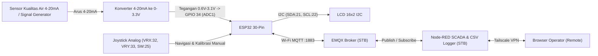
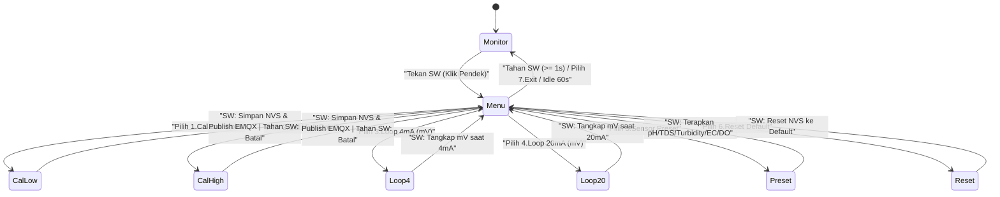
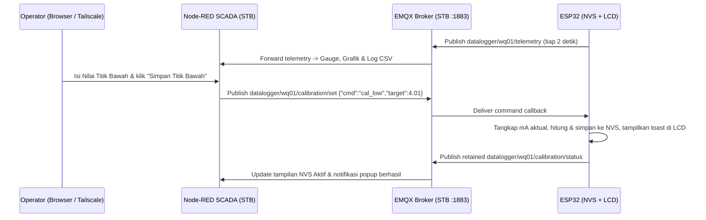

# Dokumentasi Flow Cara Kerja Sistem Data Logger 4–20 mA (ESP32 + STB SCADA)

## 1. Arsitektur Keseluruhan

---

## 2. Alur Pembacaan Sensor & Konversi 2-Titik

1. **Akuisisi Tegangan (`ADC1`):**
   - ESP32 mengambil `32` sampel dari `GPIO 34` menggunakan `analogReadMilliVolts()` (memanfaatkan kalibrasi Vref pabrik ESP32), lalu menghaluskan noise dengan *Exponential Moving Average* (`0.75 * lama + 0.25 * baru`).
2. **Konversi Tegangan (`mV`) ke Arus (`mA`):**
   $$I\text{ (mA)} = 4.0 + \frac{(V_{\text{adc}} - V_{4\text{mA}}) \times 16.0}{V_{20\text{mA}} - V_{4\text{mA}}}$$
   Nilai `V_4mA` (`mvAt4mA`) dan `V_20mA` (`mvAt20mA`) dikalibrasi memakai **Signal Generator 4–20 mA**.
3. **Deteksi Gangguan Loop (`Fault Detection`):**
   - `I < 3.50 mA` -> status `UNDER` (indikasi kabel putus / transmitter mati).
   - `I > 20.80 mA` -> status `OVER` (indikasi *over-range* / *short*).
   - `3.50 mA <= I <= 20.80 mA` -> status `OK`.
4. **Kalibrasi 2-Titik ke Nilai Sensor (Engineering Unit):**
   $$\text{Nilai} = \text{valLow} + \frac{(I - \text{calMaLow}) \times (\text{valHigh} - \text{valLow})}{\text{calMaHigh} - \text{calMaLow}}$$
   Keempat parameter (`calMaLow`, `valLow`, `calMaHigh`, `valHigh`) tersimpan permanen di **NVS (`Preferences`)** ESP32.

---

## 3. Alur Kalibrasi Lokal (LCD 16x2 + Joystick Analog)

### Kontrol Joystick
- **Di layar Monitor:** Klik pendek tombol `SW` untuk masuk ke menu utama.
- **Di Menu Utama:** Gerakkan `VRY` (Atas/Bawah) untuk memilih menu, klik pendek `SW` untuk masuk, tahan `SW` (>= 1 detik) untuk keluar ke Monitor.
- **Di Layar Kalibrasi Titik Bawah / Atas:**
  - `VRY` (Atas/Bawah): naikkan / turunkan nilai target referensi (misal `4.01` pH atau `1000` ppm).
  - `VRX` (Kiri/Kanan): ubah step kenaikan (`0.01`, `0.10`, `1.00`, `10.00`).
  - Klik pendek `SW`: menangkap arus `mA` aktual saat itu bersama nilai target -> simpan ke NVS -> kirim update otomatis ke EMQX (`calibration/status`).
  - Tahan `SW` (>= 1 detik): batal dan kembali ke menu.

---

## 4. Alur Kalibrasi Jarak Jauh (Node-RED <-> EMQX <-> ESP32)

---

## 5. Daftar Topik MQTT & Format JSON

| Topik | Arah | Retain | Fungsi |
| :--- | :--- | :--- | :--- |
| `datalogger/wq01/status` | ESP32 -> EMQX | Ya | LWT status `"online"` / `"offline"` |
| `datalogger/wq01/telemetry` | ESP32 -> EMQX | Tidak | Data sensor periodik (`adc_mv`, `ma`, `value`, `fault`, `cal_mode`, `rssi`) |
| `datalogger/wq01/calibration/set` | Node-RED -> ESP32 | Tidak | Perintah kalibrasi & pemilihan sensor dari SCADA |
| `datalogger/wq01/calibration/status` | ESP32 -> EMQX | Ya | Konfirmasi parameter NVS terbaru ke SCADA |

### Contoh Payload Perintah (`datalogger/wq01/calibration/set`)
- **Kalibrasi Titik Bawah (pakai arus mA aktual):** `{"cmd":"cal_low","target":4.01}`
- **Kalibrasi Titik Atas (pakai arus mA aktual):** `{"cmd":"cal_high","target":10.01}`
- **Set 2-Titik Langsung:** `{"cmd":"set_points","cal_ma_low":4.05,"val_low":0,"cal_ma_high":19.95,"val_high":14}`
- **Kalibrasi Loop Hardware Signal Generator:** `{"cmd":"cal_loop_4ma"}` atau `{"cmd":"cal_loop_20ma"}`
- **Ganti Preset Sensor:** `{"cmd":"set_sensor","preset":"TDS"}` (`pH`, `TDS`, `Turbidity`, `EC`, `DO`)
- **Sensor Custom:** `{"cmd":"set_sensor","sensor":"Cl2","unit":"mg/L","val_low":0,"val_high":5,"decimals":2}`
- **Reset Default:** `{"cmd":"reset"}`

---

## 6. Prosedur Wajib Uji Awal dengan Signal Generator 4–20 mA

1. **Sebelum menyambungkan `VOUT` konverter ke `GPIO 34`:**
   - Hubungkan `Signal Generator 4–20 mA` ke terminal `IN+` dan `IN-` modul konverter.
   - Berikan arus **`20.00 mA`**, ukur terminal `VOUT` ke `GND` dengan multimeter.
   - Putar trimmer **`SPAN`** hingga `VOUT` terbaca **`3.00 V` – `3.10 V`** (jangan melebihi `3.3 V`).
   - Berikan arus **`4.00 mA`**, putar trimmer **`ZERO`** hingga terbaca stabil (misal `0.60 V`).
2. **Hubungkan `VOUT` ke `GPIO 34` dan flash firmware ke ESP32.**
3. **Sinkronkan ADC ESP32 dengan Signal Generator:**
   - Set signal generator ke `4.00 mA` -> buka menu LCD `3.Loop 4mA (mV)` -> tekan `SW`.
   - Set signal generator ke `20.00 mA` -> buka menu LCD `4.Loop 20mA (mV)` -> tekan `SW`.
   - Nilai `mA` di LCD sekarang identik dengan keluaran signal generator.
4. **Uji Kalibrasi 2-Titik Lokal & Remote:**
   - Uji perubahan titik bawah/atas via menu LCD & via dashboard Node-RED, lalu restart ESP32 untuk memastikan nilai tetap tersimpan di NVS.
