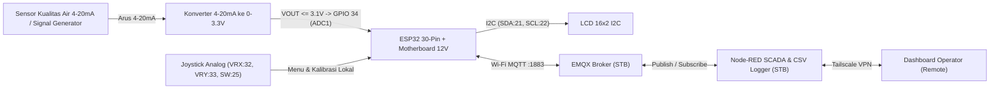
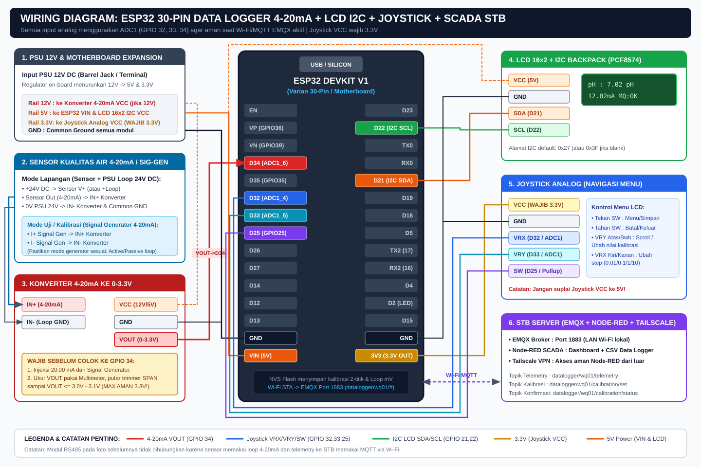

# DataLogger — Multi-Device IoT & SCADA Repository


Repositori terpusat untuk proyek **Data Logger & SCADA** lintas perangkat (ESP32, Raspberry Pi, dan node akuisisi lainnya).

---

## Daftar Perangkat

| Folder | Perangkat | Fungsi Utama | Dokumentasi |
| :--- | :--- | :--- | :--- |
| [`ESP-32/`](ESP-32/README.md) | **ESP32 DevKit V1 (30-Pin)** | Data logger sensor kualitas air `4–20 mA`, LCD 16x2 I2C, kalibrasi 2-titik lokal (joystick) & remote (MQTT EMQX + Node-RED) | [README ESP-32](ESP-32/README.md) · [Flow Cara Kerja](ESP-32/docs/FLOW_CARA_KERJA.md) |
| *(Planned)* | **Raspberry Pi / Node Lain** | Node akuisisi / gateway lanjutan | — |

---

## Arsitektur Sistem (ESP-32 + STB SCADA)



---

## Diagram Wiring ESP32 30-Pin



> Lihat berkas vektor resolusi penuh: [wiring_esp32_datalogger.svg](ESP-32/docs/wiring_esp32_datalogger.svg)

---

## Panduan Wiring & Jalur Koneksi

### 1. Jalur Catu Daya (Power Distribution)

| Sumber / Rail | Tujuan | Keterangan |
| :--- | :--- | :--- |
| **PSU 12V DC** | Input Barrel Jack / Terminal Motherboard ESP32 | Diturunkan regulator motherboard ke rail `5V` & `3.3V` |
| **Rail `5V` (Motherboard)** | `VIN` ESP32 & `VCC` LCD 16x2 I2C | Pastikan daya `5V` stabil untuk backlight LCD |
| **Rail `3V3` (ESP32 / Motherboard)** | `VCC` Joystick Analog | **WAJIB `3.3V`**, jangan ke `5V` agar pin ADC aman |
| **Rail `12V` / `5V`** | `VCC` Modul Konverter 4–20 mA | Sesuaikan rating tegangan input modul konverter |
| **PSU 24V DC (Loop Sensor)** | `+24V` ke Sensor `V+`, `0V` ke `IN-` & Common `GND` | Dipakai saat terhubung ke transmitter sensor 4–20 mA |
| **Common `GND`** | Semua modul (`PSU 12V`, `24V 0V`, ESP32, Konverter, LCD, Joystick) | Wajib terhubung bersama sebagai referensi tegangan |

### 2. Jalur Sinyal ke ESP32 (Varian 30-Pin)

| Modul | Pin Modul | Pin ESP32 30-Pin | Tipe Pin | Fungsi |
| :--- | :--- | :--- | :--- | :--- |
| **Konverter 4–20 mA** | `VOUT` | **`D34` (`GPIO 34`)** | `ADC1_CH6` (Input-Only) | Baca tegangan hasil konversi arus `4–20 mA` |
| **Konverter 4–20 mA** | `IN+` / `IN-` | *(Dari Sensor / Signal Gen)* | Loop Arus | Jalur input arus `4–20 mA` (`IN-` terhubung `GND`) |
| **Joystick Analog** | `VRX` | **`D32` (`GPIO 32`)** | `ADC1_CH4` | Navigasi kiri/kanan (ubah step kalibrasi) |
| **Joystick Analog** | `VRY` | **`D33` (`GPIO 33`)** | `ADC1_CH5` | Navigasi atas/bawah (scroll menu & ubah angka) |
| **Joystick Analog** | `SW` | **`D25` (`GPIO 25`)** | Digital `INPUT_PULLUP` | Klik pendek = pilih/simpan, tahan >= 1s = batal/keluar |
| **LCD 16x2 I2C** | `SDA` | **`D21` (`GPIO 21`)** | Hardware I2C `SDA` | Jalur data LCD (`0x27` / `0x3F`) |
| **LCD 16x2 I2C** | `SCL` | **`D22` (`GPIO 22`)** | Hardware I2C `SCL` | Jalur clock LCD |

> [!WARNING]
> **Kalibrasi Trimmer `SPAN` Sebelum Dihubungkan ke `GPIO 34`!**
> 1. Pasang *Signal Generator 4–20 mA* ke `IN+` dan `IN-` modul konverter (**jangan** hubungkan `VOUT` ke ESP32 dulu).
> 2. Set output signal generator ke **`20.00 mA`**, ukur `VOUT` dengan multimeter.
> 3. Putar trimmer **`SPAN`** sampai `VOUT` berada di **`3.00 V` – `3.10 V`** (batas maksimal ADC ESP32 adalah **`3.3 V`**).
> 4. Set ke **`4.00 mA`** dan atur trimmer **`ZERO`** (mis. **`0.60 V`**). Baru sambungkan `VOUT` ke **`D34`**.

> [!IMPORTANT]
> - Seluruh pembacaan analog menggunakan **ADC1 (`GPIO 32, 33, 34`)** karena **ADC2 bentrok dengan Wi-Fi** pada ESP32.
> - Modul **RS485** tidak dihubungkan pada skema ini karena sensor memakai arus `4–20 mA` dan pengiriman ke STB memakai **MQTT via Wi-Fi**.

---

## Ringkasan Cara Kerja & Protokol MQTT (EMQX)

1. **Baca & Filter:** ESP32 membaca `GPIO 34` (`32x` sampel `analogReadMilliVolts()` + filter EMA), mengonversi ke `mA`, mendeteksi fault (`< 3.50 mA` = `UNDER`, `> 20.80 mA` = `OVER`), lalu menghitung nilai sensor dengan **interpolasi 2-titik** yang tersimpan di **NVS (`Preferences`)**.
2. **Kalibrasi Lokal (Joystick + LCD):** Tekan `SW` untuk masuk menu (`Cal Low Point`, `Cal High Point`, `Loop 4mA`, `Loop 20mA`, `Sensor Preset`: `pH`, `TDS`, `Turbidity`, `EC`, `DO`, `Reset Default`).
3. **Kalibrasi Jarak Jauh & Logging (Node-RED + EMQX + Tailscale):**

| Topik MQTT | Arah | Fungsi |
| :--- | :--- | :--- |
| `datalogger/wq01/status` | ESP32 -> EMQX | Status koneksi LWT (`online` / `offline`) |
| `datalogger/wq01/telemetry` | ESP32 -> EMQX | Data sensor tiap 2 detik (`adc_mv`, `ma`, `value`, `fault`, `cal_mode`, `rssi`) |
| `datalogger/wq01/calibration/set` | Node-RED -> ESP32 | Perintah kalibrasi 2-titik, loop 4/20 mA, preset sensor, & reset |
| `datalogger/wq01/calibration/status` | ESP32 -> EMQX | Konfirmasi parameter NVS terbaru ke dashboard SCADA |

Detail flowchart lengkap, contoh JSON payload, dan SOP kalibrasi tersedia di [ESP-32/docs/FLOW_CARA_KERJA.md](ESP-32/docs/FLOW_CARA_KERJA.md).

---

## Quick Start

1. Atur `WIFI_SSID`, `WIFI_PASSWORD`, dan `MQTT_BROKER_HOST` (IP LAN STB) di [ESP-32/include/config.h](ESP-32/include/config.h).
2. Compile & flash ke ESP32 menggunakan PlatformIO:
   ```powershell
   pio run -d ESP-32 -t upload
   pio device monitor -d ESP-32
   ```
3. Import [ESP-32/nodered/datalogger_scada_flow.json](ESP-32/nodered/datalogger_scada_flow.json) ke Node-RED di STB (`node-red-dashboard` terpasang), klik **Deploy**, lalu akses SCADA via Tailscale (`http://<IP-TAILSCALE-STB>:1880/ui`).
